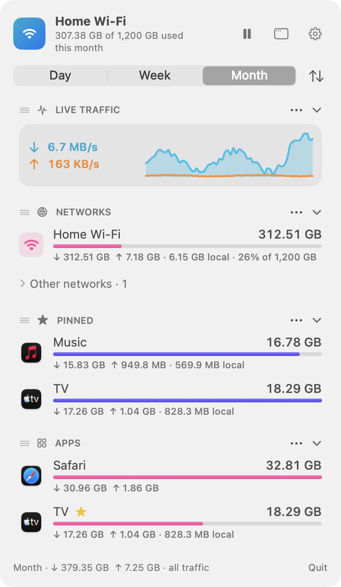
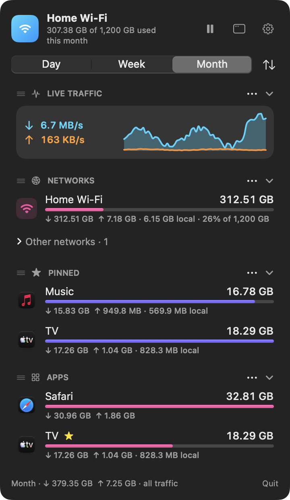
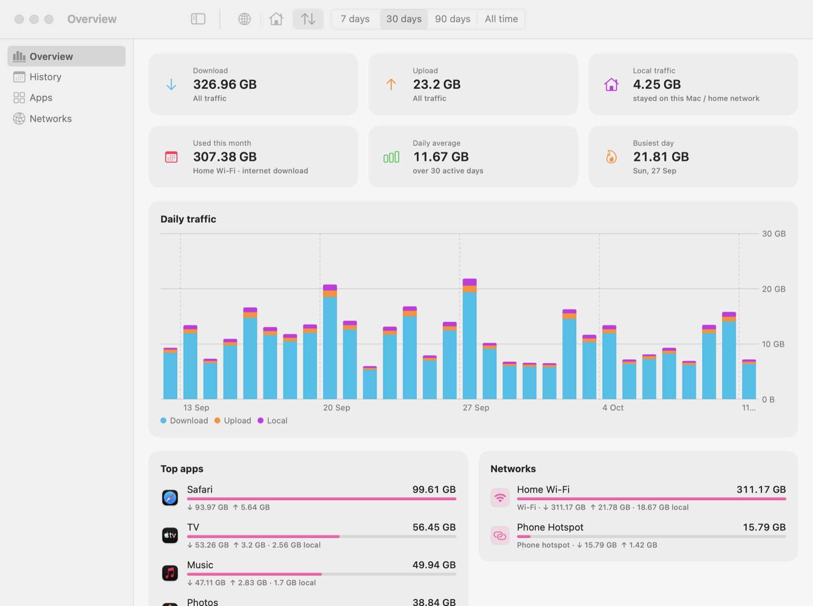
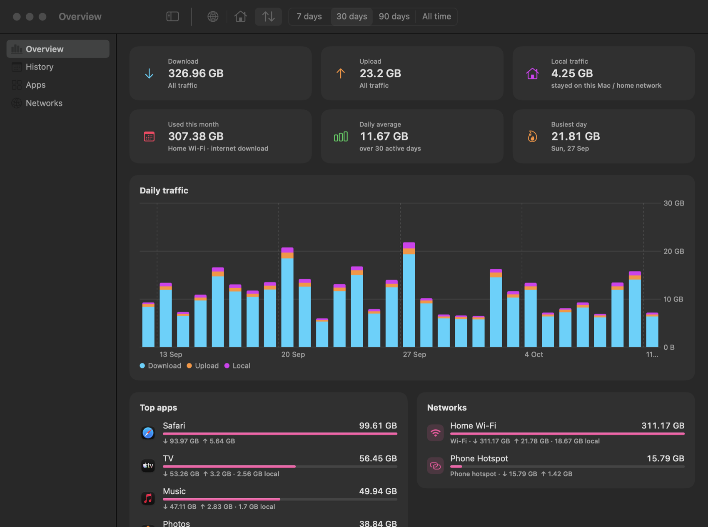
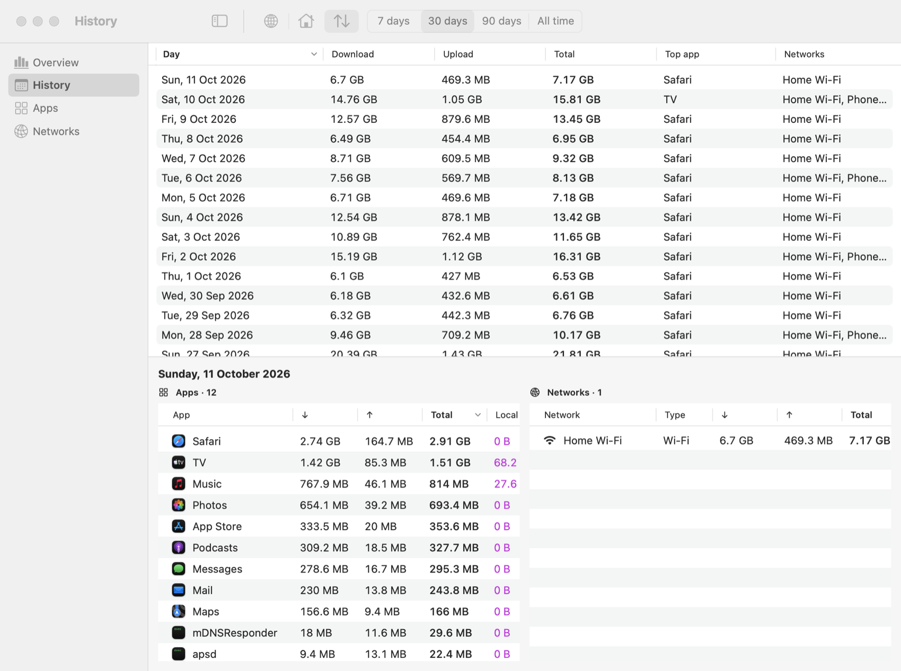
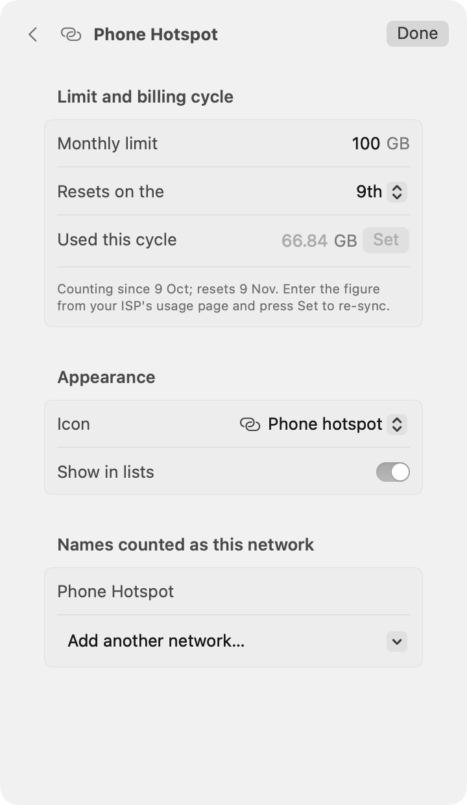
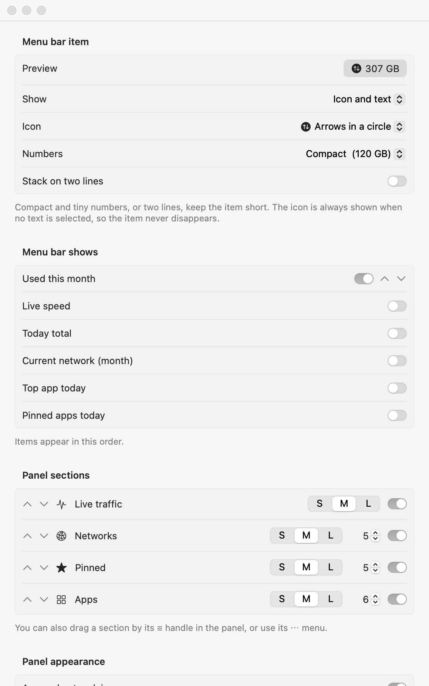

<h1 align="center">NetMeter</h1>
<p align="center">
  A menu bar app for macOS that shows what your Mac is using: live speed, usage per network and per app,<br>
  billing-cycle limits with alerts, and day-by-day history.
</p>

<p align="center">
  
  &nbsp;
  
</p>

> The screenshots use synthetic demo data (`NetMeter --demo`), not real usage.

## Features

- **Per network, with its own limit.** Set a monthly limit and the day your billing cycle resets for each network,
  for example a home connection that resets on the 1st and a phone hotspot that resets on the 9th. Right-click a network.
  Sync "used so far" with your ISP's own figure whenever you like.
- **Internet vs local.** Internet download is what your ISP meters. Traffic that stays on the Mac (Docker ↔ rclone) or
  on your home network is counted separately, and you can view Internet, Local or All.
- **Per app.** Choose the apps (or command-line tools such as rclone) to track with a Finder picker, drag-and-drop or ☆.
  Helper processes are counted with their app.
- **Alerts** as a network approaches its limit (80%, 100%, and thresholds you choose).
- **Customizable menu bar item.** Icon and/or text, a choice of icons, full / compact / tiny numbers, optional two-line
  stacking, and any order of items.
- **Main window** with an overview, a sortable day-by-day history (apps and networks for each day), and per-app and
  per-network breakdowns, plus CSV export.
- **Private.** Everything stays on your Mac. NetMeter makes no network connections of its own.
- **Light on resources.** About 1% of one CPU core.

<p align="center">
  
</p>

<details>
<summary>More screenshots</summary>

<p align="center">
  <br>
  <br>
  
  
</p>

</details>

## Install

Requires **macOS 15 or later** (Apple silicon and Intel).

1. Download `NetMeter-<version>.dmg` from [Releases](../../releases) and drag NetMeter to Applications.
2. The release is **not notarized** (it is signed ad-hoc), so macOS will block the first launch. Either:
   - Control-click NetMeter → **Open** → **Open**, or
   - run `xattr -dr com.apple.quarantine /Applications/NetMeter.app` once.
3. Allow **Location** when asked. macOS only reveals the Wi-Fi network name to apps with Location access; without it
   NetMeter still counts everything but cannot tell networks apart.

Or build it yourself (below), which needs no approval.

## How it measures

| What | How | Accuracy |
|---|---|---|
| Network totals, "used this month" | Interface byte counters, every 2 s | Exact |
| Per-app and internet/local split | A one-shot `nettop` snapshot every 5 s (about 30 ms CPU), diffed per connection | Totals are reconciled to the exact counters; which app a closing connection's last seconds belong to is estimated |

Connections that open and close between two snapshots are missed by the per-app view (the reconciliation hands those
bytes to recently active apps). The sampling interval is in Settings → General → Performance.

## Build

```sh
./build.sh          # NetMeter.app, universal, ad-hoc signed
open NetMeter.app
swift test          # unit tests
NetMeter.app/Contents/MacOS/NetMeter --demo   # synthetic data, touches nothing on disk
```

Needs Xcode 16 or later (Swift 5.9+ language mode, macOS 15 SDK).

### Shipping a signed, notarized build

NetMeter runs `/usr/bin/nettop`, so it cannot be sandboxed and is distributed outside the Mac App Store
(Developer ID + notarization).

```sh
export CODESIGN_IDENTITY="Developer ID Application: Your Name (TEAMID)"
export NOTARY_PROFILE=netmeter-notary     # from: xcrun notarytool store-credentials
export BUNDLE_ID=com.yourname.netmeter    # if you fork
./release.sh                              # → dist/NetMeter-<version>.dmg, signed, notarized, stapled
```

Bump `VERSION` for each release. The hardened runtime and the Location entitlement (`NetMeter.entitlements`) are applied
automatically.

## Data

Usage history lives in `~/Library/Application Support/NetMeter/data.json` (about 13 months are kept). Settings → Data can
export CSV, show the folder, or erase history. To uninstall, delete the app and that folder.

## Limitations

- Not notarized in the published releases (no Apple Developer ID yet); see Install.
- Auto-update, localization, and an Icon Composer (`.icon`) app icon for the macOS 26 look are not included yet.
- Safari's traffic runs in a system process (`com.apple.WebKit.Networking`); track it by name.

## License

[MIT](LICENSE)
